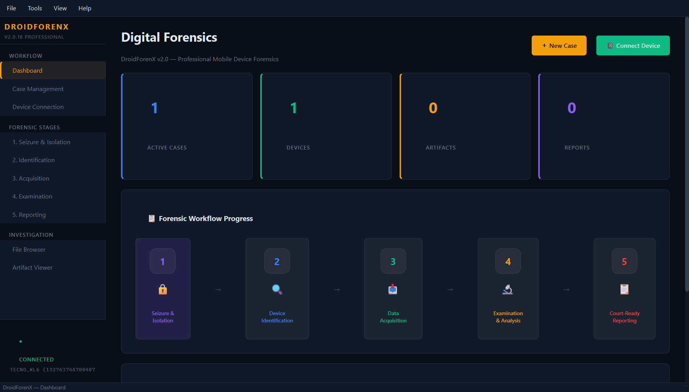
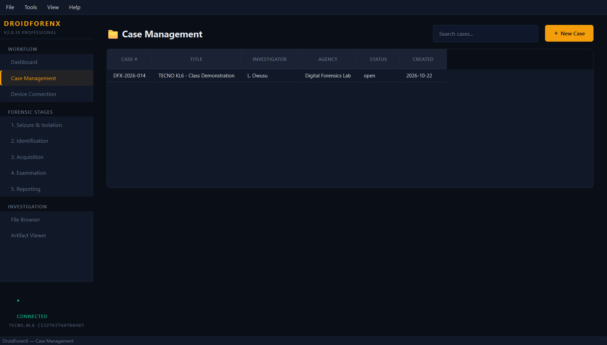
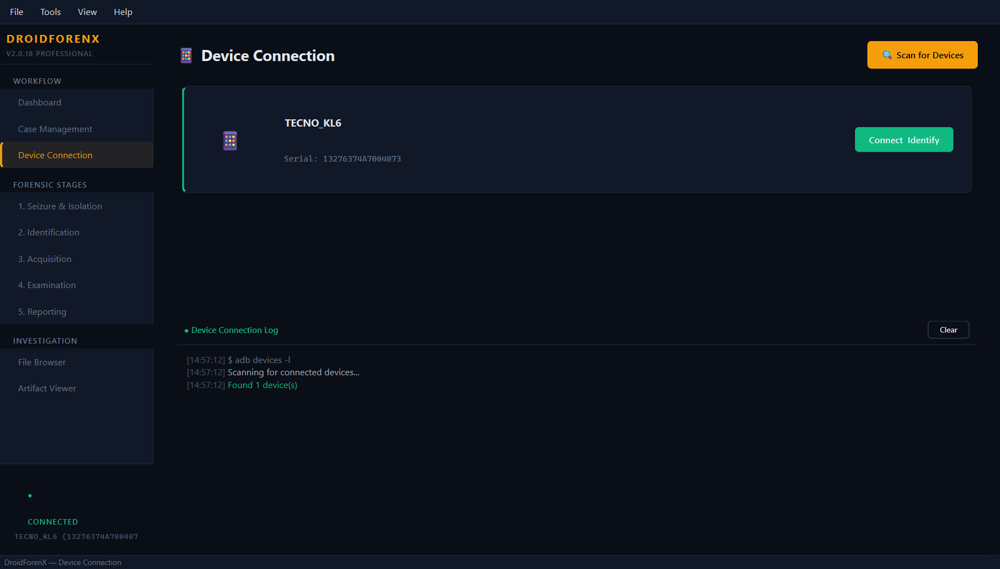
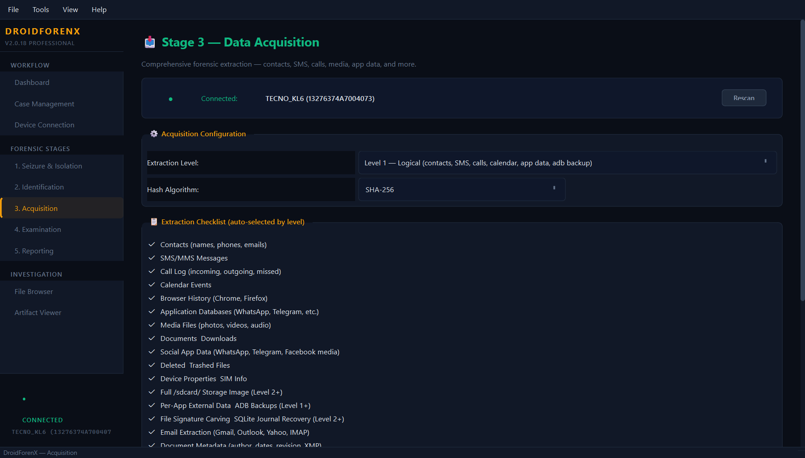
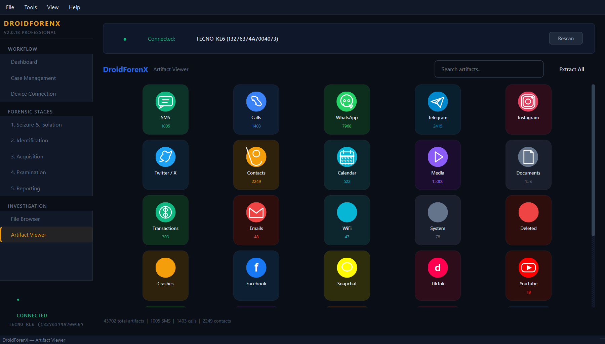
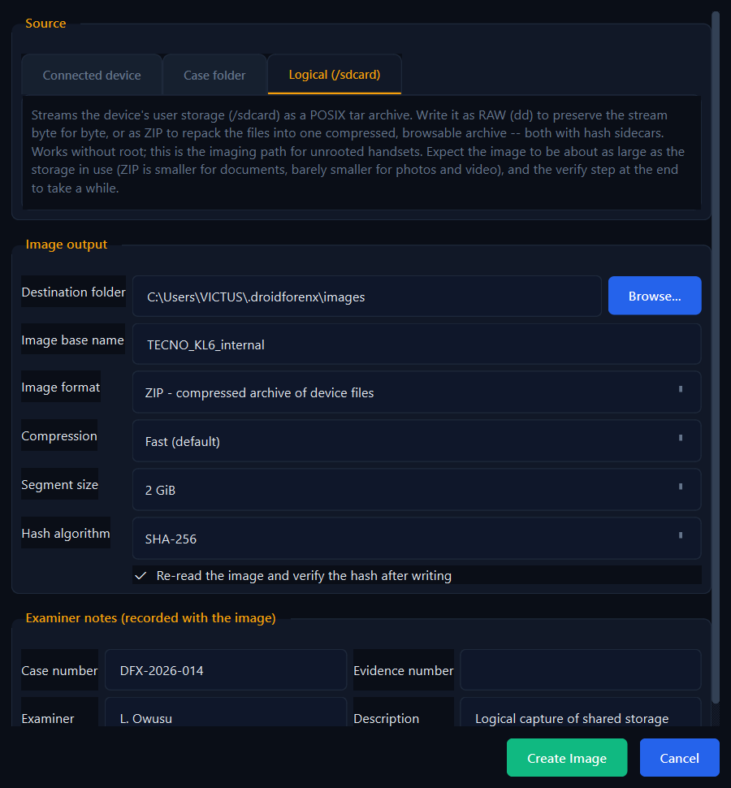
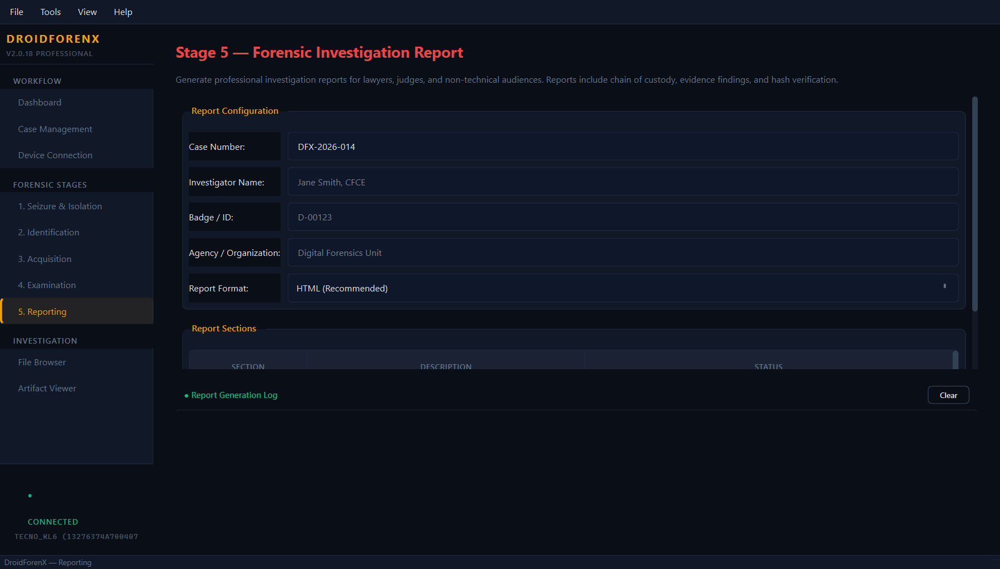
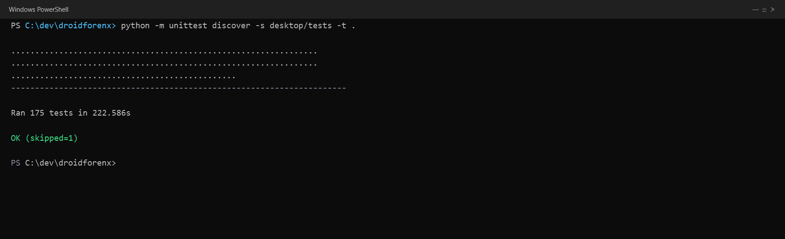

# DroidForenX

A Python desktop application for **logical acquisition and analysis of Android
devices** over ADB, built for authorised digital-forensic examination.

It pulls artifacts from a connected device, **preserves every byte it acquires**,
hashes each artifact at the moment of acquisition, parses from the preserved
copy, and records an append-only chain of custody for every action.

> ### Current verification status — read this first
>
> Verified against a real device on **14 October 2026**.
>
> | Claim | Status |
> |---|---|
> | Evidence preservation, hashing, custody, tamper detection | **Tested** — 22 automated tests, no device needed |
> | RAW / ZIP image output | **Tested** - writers, recording and the Create Image dialog, no device needed |
> | 24 acquisition loaders implemented | **Code complete** |
> | Device-verified loaders | **14 of 24** |
> | Root-gated, reported `NOT_ACCESSIBLE` | **10 of 24** |
>
> **Verified device:** TECNO TECNO KL6 (Tecno Spark 30), Android 14 (API 34),
> serial `13276374A7004073`, build `TECNO/KL6-OP/TECNO-KL6:14/UP1A.231005.007/260709V1745:user/release-keys`,
> **not rooted**, FBE `encrypted`, bootloader `green`.
>
> Every T1 claim above is stored in the case's `verification.jsonl` with that
> serial, build fingerprint, date and observed row count as its evidence. A
> `T1_DEVICE_VERIFIED` claim must now also say what it stands on:
> `record_verification()` takes an `artifact_id` that must already exist in the
> case's artifact log, or `capability_only=True` for a probe that proved the
> loader could reach the source without preserving anything. Claims of the
> second kind are stored with `basis="capability"`, and
> `audit_claims()` lists them separately so reachability is never read as
> preserved evidence. The baseline case above is of that kind — it pulls no
> content by design, and `verify()` reports its 14 claims as unbacked.
>
> `README.md` in earlier revisions of this repository described a Django +
> PostgreSQL platform with 16 phases and ~138 tests. **That software does not
> exist in this repository.** It was removed in commit `f761d7e`. This document
> describes only code that is present.

---

## Screenshots

Every frame below is the running application, not a mock-up, captured on
**21 October 2026** with a **TECNO KL6** (Tecno Spark 30, Android 14 / API 34,
unrooted) attached over ADB. The case is a throwaway demonstration case; the
artifact counts, contacts, messages and calls are read from the phone. Click an
image to open it at full size.

**Dashboard** — open cases, attached devices, artifact and report totals, and
where the current case sits in the five-stage workflow.



**Case management** — every case the operator has opened, with investigator,
agency and status. A case is the container for sessions, images and reports.



**Device connection** — model, Android version, build fingerprint, serial,
storage and root state, read over ADB.



**Acquisition** — pick an extraction level and the loaders to run. Level 1 is
logical (contacts, SMS, calls, calendar, app data, ADB backup); Level 2 adds
shared storage and carving.



**Artifact viewer** — what came back, grouped by app and category. This frame
was taken against the phone: 1005 SMS, 1403 calls and 2249 contacts in one pass.



**Create Image** — logical `/sdcard` capture as a streamed ZIP, which is the
supported path for an unrooted handset. RAW and E01-style segmented output are
available for rooted devices and case folders.



**Reporting** — a plain-English, court-ready report built from the case's
preserved artifacts and chain of custody.



**Tests** — the suite that guards acquisition, hashing, custody, imaging and the
UI. No device is needed to run it:

```powershell
python -m unittest discover -s desktop/tests -t .
```



---

## The honesty guarantee

DroidForenX reports what it actually achieved, per loader, using an eight-state
engine (`desktop/core/evidence_store.py`):

| Status | Meaning |
|---|---|
| `ACQUIRED` | Data was pulled and items were recovered |
| `PARTIAL` | Some items recovered, some failed |
| `RECOVERED` | Deleted/previous-version content recovered |
| `DELETED_RECOVERABLE` | Deletion detected, recovery possible |
| `DELETED_UNRECOVERABLE` | Deletion detected, content beyond recovery |
| `NOT_ACCESSIBLE` | Blocked by permissions (usually root required) |
| `NOT_PRESENT` | Loader ran fine; the device held nothing of that type |
| `FAILED` | The loader raised an error |

Two rules enforce this:

1. **A loader that recovered nothing is never reported as success.** It gets
   `NOT_PRESENT`, not `ACQUIRED`. The old code marked every non-throwing call
   `"completed"` regardless of results.
2. **Verification tiers are earned, never declared.** There is no table of
   "verified" loaders. A loader is `T3_UNTESTED` until a run records evidence
   for a higher tier in the case's `verification.jsonl`. Claiming
   `T1_DEVICE_VERIFIED` without recording device serial, OS build and date is
   **rejected by the code** — see `record_verification()`. All 24 loaders
   currently hold an earned status recorded on the device above.

---

## Requirements

- **Python 3.11+**
- **Android platform-tools** (ADB) — bundled under `tools/platform-tools/`, or
  install Android SDK Platform Tools
- Device with **USB debugging** enabled
- Windows / Linux / macOS

### Windows

```powershell
# 1. Virtual environment
py -m venv .venv
.\.venv\Scripts\Activate.ps1

# 2. Dependencies
pip install -r requirements.txt
```

Then run `desktop\run.bat`, or `python -m desktop.main`.

### Linux (Kali, Debian, Ubuntu, Fedora)

DroidForenX is developed on Windows and runs unchanged on Linux. Kali needs
three extra steps: the Qt6 system libraries, the udev rules, and a bundled adb.

```bash
# 1. System packages for Qt6
sudo apt update
sudo apt install -y python3-venv python3-pyqt6 libxcb-cursor0 libxkbcommon-x11-0

# 2. Virtual environment
python3 -m venv .venv
source .venv/bin/activate

# 3. Dependencies
pip install -r requirements.txt
```

Then run `./desktop/run.sh`, or `python3 -m desktop.main`.

#### udev rules (required on Linux)

Without these rules only root can talk to the device, and you would be forced
to run the whole application under `sudo` — which for a forensic tool means
writing case evidence as root and leaving root-owned files behind.

```bash
sudo cp tools/99-android-rules.rules /etc/udev/rules.d/99-android-rules.rules
sudo udevadm control --reload-rules
sudo udevadm trigger
```

Unplug and replug the device, then confirm it lists as `device` (not
`unauthorized`):

```bash
adb devices -l
```

#### adb on Linux

`run.sh` uses whichever it finds first:

1. `DROIDFORENX_ADB_PATH` environment variable, if set and present
2. the bundled copy in `tools/platform-tools/`
3. `adb` on `PATH` (Kali ships it as `android-tools-adb`)

To install the bundled copy explicitly:

```bash
python3 setup_adb.py          # download official platform-tools
python3 setup_adb.py --check  # report availability
```

If the bundle is missing, `sudo apt install android-tools-adb` also works — the
tool falls back to `PATH` automatically.

### macOS

```bash
python3 -m venv .venv && source .venv/bin/activate
pip install -r requirements.txt
python3 -m desktop.main
```

`requirements.txt` installs `PyQt6`, `fpdf2`, `openpyxl`, `Pillow`,
`pyinstaller`.

---

## Running

```powershell
python manage.py gui        # launch the desktop application
python manage.py version    # print version information
```

On Linux the equivalent is `python3 manage.py gui`, or simply `./desktop/run.sh`
from the repository root.

### Connecting a device

1. Enable **Developer options → USB debugging** on the phone.
2. Set USB mode to **File Transfer (MTP)** — charging-only mode hides content
   providers from ADB.
3. Connect by USB and accept the **Allow USB debugging** prompt on the phone.
4. Confirm the device appears:

```powershell
# Windows
.\tools\platform-tools\adb.exe devices -l
```

```bash
# Linux / macOS
adb devices -l
```

The phone must be **unlocked** for the authorisation prompt to appear.

---

## Architecture

A self-contained PyQt6 desktop application. No web server, no external
database, no network calls during acquisition.

```
desktop/
  main.py                     entry point + global crash handler
  core/
    adb_manager.py            ADB discovery, shell, pull, root detection
    evidence_store.py         case tree, hashing, custody, status, tiers
    forensic_engine.py        the 24 loaders
    database.py               SQLite helper
    doc_metadata.py           document metadata extraction
    email_extractor.py        email artifact extraction
    sim_forensics.py          SIM / network operator analysis
  ui/
    main_window.py            window shell, stage navigation
    theme.py                  palette and typography
    pages/                    home, identify, seize, case, acquire,
                              examine, artifacts, browse, device, report
    widgets/                  data table, log console, status bar, stage bar
  tests/                      unittest suites
tools/platform-tools/         bundled ADB
manage.py                     CLI wrapper (gui | version)
```

### Case storage layout

Per case, under `EVIDENCE_ROOT`, which defaults to:

- `%USERPROFILE%\.droidforenx\evidence` (Windows)
- `~/.droidforenx/evidence` (macOS / Linux)

Override with the `DROIDFORENX_EVIDENCE_ROOT` environment variable. Evidence is
deliberately kept out of the repository and out of any web-served path.

### Reports

Two outputs are generated from a case, and both contain **evidence only** — no
AI output:

```bash
# PDF evidence report
python -m desktop.report.evidence_report CASE-BASELINE-001

# XLSX verification workbook
python -m desktop.report.evidence_workbook CASE-BASELINE-001
```

The **PDF** is the narrative report: case header, device scope, the per-loader
status table, earned verification tiers, the manifest, and the chain of custody.

The **XLSX** is the examiner's working copy, with sortable and filterable
sheets: `Case Summary`, `Integrity`, `Sources`, `Artifacts`, `Custody`. Its
`Integrity` sheet independently re-hashes every artifact and reports `OK`,
`MISMATCH` or `MISSING` per file, showing the manifest digest beside the
re-computed one. A file that is missing from disk leaves the re-computed column
blank rather than echoing the manifest digest. Building it is strictly
**read-only** — it never writes to the case tree and never appends a custody
event, so producing a report cannot alter evidence. Use
`evidence_store.verify()` when you *want* the verification run recorded in the
log.

Both outputs are also reachable from the app: on the **Stage 5** report page,
pick `Verification Workbook (XLSX)` as the report format and the workbook is
written alongside the other report artifacts. The workbook is derived from the
evidence store, so the case number is used as the evidence-store case id; if no
manifest exists for it, the workbook records `NO_MANIFEST` instead of implying
that integrity was verified.

```
<case_id>/
  case.json                  case metadata, written once at open
  acquired/                  IMMUTABLE — every byte pulled from the device
  parsed/                    derived output — regenerable, never evidence
  manifests/
    SHA256SUMS                "<sha256>  <path>" per acquired artifact
    custody.jsonl             append-only chain of custody
    artifacts.jsonl           append-only artifact register
    status.jsonl              append-only per-loader outcome log
    verification.jsonl        append-only record of earned verification tiers
```

**Invariants**

- Nothing in `acquired/` is ever modified or deleted by analysis code. Parsers
  read *from* it; results go to `parsed/`.
- Every acquired file is SHA-256 hashed at acquisition time.
- `custody.jsonl`, `artifacts.jsonl`, `status.jsonl` and `verification.jsonl`
  are append-only. This module contains no truncate, rewrite or delete of a
  log record.
- `verify(case_id)` re-hashes `acquired/` and returns
  `VERIFIED` / `INTEGRITY_FAILURE`, listing modified and missing files.
- Case identifiers are sanitised, so a crafted case ID cannot traverse out of
  the evidence root.

### Images

Acquisition writes a folder tree. When a container is wanted instead — the way
FTK Imager's *Create Disk Image* works — use **Stage 3 → Create Image**. The
dialog picks a source, an output format, and the parameters for it.

| Format | Source | Output |
|---|---|---|
| **Raw (dd)** | a device partition | `evidence.001`, `evidence.002` … (or one `evidence.dd`), plus `.md5`/`.sha1`/`.sha256` sidecars and an `.imageinfo.txt` |
| **Raw (dd), logical** | the device's `/sdcard` | the same RAW container, holding a POSIX tar archive of user storage streamed over `adb exec-out` |
| **ZIP** | a case folder | `evidence.zip` with a `MANIFEST.json` inventory, plus a hash sidecar |
| **ZIP, logical** | the device's `/sdcard` | `evidence.zip` with every file from the tar repacked into a browsable archive, a per-file hash inventory in `MANIFEST.json`, plus a hash sidecar |

Source and format are gated against each other: a block device can only be
written as RAW, the logical tar stream as RAW or ZIP, and a folder only as ZIP.
Segment size (default 2 GiB, or a single file), compression and hash algorithm
are selectable, and the image is re-read and re-hashed after writing unless
verification is turned off.

The **Logical (/sdcard)** tab is the imaging path that works on an unrooted
handset: the ADB shell cannot open block devices there, but it can read
`/sdcard`, so user storage is streamed as a tar archive and written through the
RAW writer — or repacked on the fly into a compressed ZIP — with the same
hashing, verification and recording. ZIP is worth choosing for documents and
databases; photos and video are already compressed, so the saving there is
small. Both are logical captures: deleted files and app-private data are not in
them, and the ZIP holds files rather than a byte-for-byte stream.

Every finished image is recorded: a `disk_images` row, an `ACQUIRED` custody
event, and one `record_acquired` artifact per segment, so it appears in the
manifest and `SHA256SUMS` like anything else. A verification that failed, or was
skipped, is recorded as such — it is never written down as `complete`.

The whole feature is standard library only. There is no `libewf`, no bundled
native binary, and no third-party dependency to install.

| Writer | Module | Source kind |
|---|---|---|
| RAW | `desktop/core/imaging/raw.py` | a file-like reader |
| ZIP | `desktop/core/imaging/zip.py` | a folder |
| ZIP stream | `desktop/core/imaging/zipstream.py` | a file-like tar reader |
| Device/folder sources | `desktop/core/imaging/sources.py` | — |
| Recording | `desktop/core/imaging/registry.py` | — |

The writers never touch ADB, which is what makes them testable without hardware.

---

## The 24 loaders

**Device-verified — readable on this unrooted phone** (14). Each was confirmed by
a live read-only query on the TECNO KL6 above; observed volumes are in
`verification.jsonl`:

`call_log` (1403) · `sms_mms` (983) · `contacts` (694) · `calendar` (530) ·
`gps` · `wifi` · `bluetooth` · `apps` · `installed_apps` (423 packages) ·
`app_permissions` · `clipboard` · `notifications` · `usage_stats` · `notes`

**Root-gated — confirmed `NOT_ACCESSIBLE`** (10). They read app-private
`/data/data/<pkg>` or keystore `/data/misc/wifi` paths, and Android denies the
shell. The probe confirmed `permission denied` on every one; they are recorded
and surfaced, never silently dropped:

`whatsapp` · `telegram` · `instagram` · `snapchat` · `tiktok` · `facebook` ·
`transactions` · `browser` · `wifi_passwords` · `deleted`

`whatsapp` carries a second and separate caveat. Extracting WhatsApp data was
within this project's planned scope, but the work was never completed or
validated, so the loader is surfaced as unavailable rather than presented as
working. It stands as future work; any implementation should stay within
authorised forensic work and documented lawful exports. *(Recorded by
te7mina1 in `c6d2998`.)*

`is_device_rooted()` and `device_root_summary()` in `adb_manager.py` perform
root detection so the tool knows its own ceiling before interpreting results.

### Reproducing the baseline

```powershell
python probe_device.py      # read-only capability probe; pulls nothing
python record_baseline.py   # opens a case, records statuses + earned tiers
```

Both are non-destructive. `probe_device.py` performs no writes and no pulls;
`record_baseline.py` deliberately pulls **no personal content** — it records
capability, integrity and chain of custody only.

---

## Limitations

State these in any report; they are properties of Android, not bugs to be
"fixed" by this tool.

- **App-private data needs root.** Since Android 7, `/data/data/<pkg>` is
  unreadable to the ADB shell. Without root, messaging, social media, browser
  history, saved WiFi keys and mobile-money data cannot be acquired.
- **Modern WhatsApp encrypts its database.** Even with root, current WhatsApp
  uses a keystore-derived key (crypt15). Recovery typically requires the
  crypt file and a pre-upgrade copy, or a full filesystem image.
- **Scoped storage** (Android 10+) limits shared-storage visibility per app.
- **Multiple Android users.** A device carrying a secondary user or work profile
  makes plain `pm list packages` abort with
  `SecurityException: Shell does not have permission to access user 999`,
  returning error text instead of a package list. All `pm list` calls go
  through `adb_manager.pm_list()`, which scopes to `--user 0` and falls back to
  the unscoped form on older builds. This bug silently produced **zero**
  packages on this device before the fix.
- **Modern social apps** network their content through private APIs. DroidForenX
  performs **no** account logins and **no** API calls to social platforms. It
  reads only local files that an authorised, properly unlocked device exposes.
- **Logical acquisition is not a full image.** Files not written to accessible
  storage are not recovered. A full flash image is a separate procedure with
  its own legal authorisation requirement.
- **Physical imaging needs root — often for every partition, `boot` included.**
  *Create Image* probes each partition with a one-sector read before offering
  it. On the unrooted TECNO used for verification the shell user is denied every
  block device (65 of 65, `boot` included), so the dialog reports `0 of 65
  readable` and marks them `needs root` rather than attempting a doomed stream.
  The **Logical (/sdcard)** tab is the supported unrooted path; `userdata` and
  whole-disk capture require a rooted device or an authorised physical procedure.
- **Encryption**: a device with a locked FBE screen yields little.

---

## Testing

```powershell
python -m unittest `
  desktop.tests.test_evidence_store `
  desktop.tests.test_evidence_workbook `
  desktop.tests.test_forensic_engine `
  desktop.tests.test_imaging `
  desktop.tests.test_image_registry `
  desktop.tests.test_create_image_dialog `
  desktop.tests.test_theme `
  desktop.tests.test_main_window `
  desktop.tests.test_ui_export `
  desktop.tests.test_reproducible_build -v
```

A release build should install from `requirements-lock.txt` rather than
`requirements.txt`. The lock pins every dependency including the transitive ones,
and `build.py` takes `SOURCE_DATE_EPOCH` from the HEAD commit, so two builds of
the same commit produce a byte-identical executable and the published SHA-256
can be reproduced by anyone. `test_reproducible_build.py` compares the installed
environment against the lock, and the full two-build byte comparison runs only
with `DROIDFORENX_SLOW_TESTS=1`.

165 tests, no device required. They cover the properties that matter:

- an acquired artifact survives being read (the original bug was that 11
  loaders deleted evidence after parsing)
- acquired artifacts are hashed on write
- SHA-256 manifests and the custody log are written correctly
- custody is append-only across re-opens, and case metadata is not overwritten
- `verify()` detects both **tampering** and **deletion**
- a loader recovering nothing is `NOT_PRESENT`, not success
- verification tiers cannot be claimed without evidence
- case export refuses to write into the evidence tree (which would destroy the
  case being copied)
- derived output in `parsed/` does not alter the evidence count
- case IDs cannot traverse out of the evidence root

The workbook tests (`test_evidence_workbook.py`) pin the reporting half:

- the `Integrity` sheet's re-computed column is a hash taken from the file on
  disk, so a tampered artifact shows a different digest and a missing one shows
  none
- a case with no manifest reports `NO_MANIFEST` rather than implying verification
- building a workbook leaves the case tree and the custody log byte-for-byte
  unchanged

The engine tests (`test_forensic_engine.py`) pin the acquisition edge cases:

- `_unique_name()` never hands out a name that already exists, so pulling two
  files that share a basename — or pulling the same path repeatedly — cannot
  overwrite an earlier artifact
- a pull that ADB cannot read is recorded as `NOT_ACCESSIBLE`, and a zero-length
  pull as `NOT_PRESENT`; neither leaves an artifact in `acquired/`

The UI tests (`test_ui_export.py`) run a headless Qt application and generate
each report format, proving the default **HTML** renders its custody log, the
**PDF** folds typographic characters instead of raising, and the **XLSX**
workbook is readable. They also cover `PullFileWorker`'s success and failure
contracts. This module is skipped when PyQt6 cannot start an application.

The image-writer tests (`test_imaging.py`) exercise the writers without a device:

- RAW segments concatenate back to the original bytes and hash to the same
  digest as the source, and a source that ends exactly on a segment boundary
  does not leave a phantom zero-byte segment behind
- the sidecar and `.imageinfo.txt` carry the real image digest, and the info file
  records the verification result rather than a default
- `verify()` catches a modified segment or container, so a tampered image is not
  reported as verified
- a failed or empty acquisition leaves no half-written image on disk
- the device layer builds the right `adb exec-out` command, discards stderr
  inside the device shell, and refuses to call an unreadable partition available

The registry tests (`test_image_registry.py`) pin the recording half:

- the `disk_images` migration is idempotent and safe to re-run on an existing
  database
- a finished image gets a row with the real format, digest, segment list and
  verification outcome
- a failed verification is recorded as `failed`, not `complete`
- every segment lands in the manifest and the custody log

The dialog tests (`test_create_image_dialog.py`) run a headless Qt application
and check the source/format gating (a device offers RAW only, a folder offers ZIP
only, the logical tab offers RAW and ZIP), that the built request is one the
writers accept, that an invalid base
name is rejected before anything is written, and that an unreadable partition is
refused rather than dispatched. No ADB call is made.

They also pin the dialog's own geometry, which is where it used to go wrong on a
720 px screen: the requested size is capped to the available desktop, the action
row sits outside the scroll area so it cannot be scrolled away from, and the
window clamp works from the *frame* rectangle rather than the client one. That
last distinction is the difference between a window whose geometry computes as
fitting and one that actually fits — the title bar is 30 px of the window that a
client-only sum leaves out.

The theme tests (`test_theme.py`) pin the light/dark switch:

- the central one is a coverage guard. Every hex literal under `desktop/ui` must
  either have a light counterpart or appear in the explicit allowlist of colours
  that must *not* translate — brand marks and the printed report's document
  palette. Adding a new dark colour without a counterpart fails the suite instead
  of shipping a label that is invisible on white.
- dark mode is an identity transform, so the shipped look is byte-for-byte
  unchanged
- body text clears 7:1 against every light surface, muted text clears 4.5:1, and
  the deliberately faint tertiary text is no worse than it is in dark mode
- switching themes repeatedly does not drift: the widget's *recorded* source is
  re-translated each time, so nothing is darkened twice
- a widget built after a switch is themed immediately, and one built before it is
  re-themed on change

The main-window test (`test_main_window.py`) measures the sidebar's chrome instead
of trusting it:

- every label in the sidebar must be given at least as much content height as the
  font it draws. The product name and the device status footer both had a
  text box of a few pixels, which is not visible in any reading of the style
  rules — a selector-less `padding` is inherited by children, and `QFrame`
  matches `QLabel` children because `QLabel` derives from `QFrame`
- the sidebar's natural height must fit what a 1280x720 desktop leaves it, since
  a sidebar that asks for more is squeezed and its labels are the first casualties
- the Seizure nav caption keeps its literal ampersand: a lone `&` is a Qt
  mnemonic and silently consumes a character

`desktop/tests/` also contains `test_quick.py`, `test_deep.py` and
`test_full_adb.py`. These require a connected device and are **not** covered by
CI. `integration_smoke.py` is a standalone script that checks imports and files;
it is deliberately not named `test_*` so unittest discovery does not import a
module that exits the interpreter.

---

## Scope

DroidForenX is an **analysis and acquisition tool for authorised examination**.
It does not and will not include: credential or PIN cracking, FRP or lock-screen
bypass, rooting or unlocking of seized devices, exploitation, spyware, or
unauthorised access. Use only on devices you are lawfully authorised to examine.

Image output is no exception. *Create Image* writes a container from a source the
tool can already read — it does not raise an unrooted device's privileges, does
not bypass encryption, and does not read anything the acquisition stage could not
already read.

---

## AI Assist — **not implemented**

`.env.example` contains keys for an optional AI assistance layer
(`OPENROUTER_API_KEY`, `DROIDFORENX_AI_*`). **None of it is built yet.** There
is no code in this repository that reads those variables, calls OpenRouter, or
produces AI output. They are listed so the intended design is on record.

If built, the rules it must follow are fixed in advance:

- AI output is **never** evidence and **never** enters the evidence chain. It
  lives in a separate store and is excluded from the evidentiary findings.
- Every AI call records model, prompt hash, parameters, timestamp and the
  artifact IDs it was given, so any AI-derived statement is traceable to source.
- PII (numbers, emails, names) is redacted locally before anything leaves the
  host, and AI features are off by default and opt-out per case.
- A human examiner confirms anything AI-derived before it appears in a report.

Deleting the `DROIDFORENX_AI_*` lines changes nothing about how the tool works.

---

## Configuration

Optional `.env` (gitignored; see `.env.example`). All acquisition, hashing,
custody and reporting features work **without** any `.env` file — configuration
is only needed for optional AI assistance, which is deliberately kept outside the
evidence chain and does not affect acquisition results.

```powershell
DROIDFORENX_EVIDENCE_ROOT=evidence
DROIDFORENX_AI_ENABLED=false
DROIDFORENX_AI_MODEL=meta-llama/llama-3.1-8b-instruct
DROIDFORENX_AI_REDACT=true
```

### Theme

The interface ships **dark** and can be switched to **light** or **follow the
system** from `View ▸ Dark Theme / Light Theme / Follow System Theme`
(`Ctrl+1`, `Ctrl+2`, `Ctrl+3`). The choice is remembered in `QSettings`, so the
next launch opens in it, and "follow the system" keeps tracking changes while the
application is running rather than resolving once at startup.

Dark is the default and is byte-for-byte unchanged from earlier builds. Light is
a designed palette, not an inversion: cards rise to white on a tinted page, body
text clears WCAG AAA against every surface, and each accent is darkened one step
so it still holds up on white.

Two things are deliberately *not* themed. Brand marks in the artifact viewer keep
their real colours, and the exported HTML report keeps its own document palette —
a report is a file someone else reads, and it should not change appearance
because an examiner flipped a UI preference.